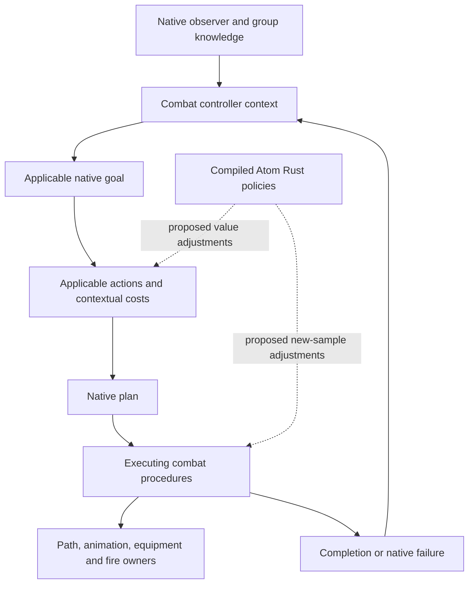

# Atom AI behavior and first-version feasibility

## Outcome and status

Atom can plausibly improve combat through small Rust policies around the
existing native planner. The evidence supports investigating that approach
before building a replacement planner or a separate actor update loop.
Parameter ownership needs to include decision scope, native sampling time,
knowledge provenance, and action completion. Owning a collection of numbers
alone will not provide those properties.

Three findings materially change the implementation discussion:

- The native planner has goals, applicability checks, contextual action costs,
  generated plans, and separate executing procedures. A numeric cost boundary
  already receives the combat controller, rather than only a shared style.
- Four native group strategies exist, but their selector is bypassed by a
  registered setting whose executable default disables them. Their existence
  is not evidence of effective, safe squad behavior in gameplay.
- Native aiming branches on a projectile form's hitscan flag before Atom's
  physical-flight choice occurs. The resulting aiming/flight disagreement is
  a concrete integration question to test, not a demonstrated aiming defect.

This study closes static knowledge gaps. It does not establish the cause of
every apparently foolish action, a balanced set of defaults, a safe installed
hook, or an observed gameplay improvement. No game session was run for this
continuation. No production code was changed. The first-version outline below
is conditional on named native and behavioral gates; it carries no release
qualification or schedule estimate.

The complete setting/style inventory and prior ownership, timing, weather,
and worker evidence remain in [AI policy research](atom_ai_policy_research.md).
This document studies behavior and intervention feasibility rather than
repeating the numeric inventory.

## What improved AI should mean

The requested outcome is enemies whose decisions look purposeful. The
following are proposed product criteria, not claims about reproduced defects:

| Player-visible result | What would count as evidence | What does not establish it |
|---|---|---|
| Use protection sensibly | Complete a reachable cover maneuver when protection is useful, then resume a useful attack | A higher cover percentage or more path requests |
| Manage ammunition sensibly | Reload at an appropriate opportunity and avoid repeated unnecessary transitions | Setting both reload thresholds to full capacity |
| Respond when a shot is blocked | Change a failed firing opportunity into a valid position or another valid action | Repeatedly restarting the same blocked procedure |
| Use suitable weapons | Pick an available, usable weapon for the actual encounter and commit long enough to use it | A shorter inventory timer or unlimited engagement range |
| Search credibly | Distinguish current observation, shared information, and an older location; allow a successful escape | Tracking the player's current position through an occluder |
| Maintain pressure without looking erratic | Finish useful actions, react to material changes, and avoid rapid reversals | More frequent replanning or maximum aggression |
| Behave as different kinds of enemies | Respect equipment, mobility, authored restrictions, and native capabilities | Applying a human gunfighter profile to every actor |
| Coordinate meaningfully | Another actor's maneuver changes a teammate's useful opportunity | Several enemies independently choosing the same point |

Difficulty, damage, accuracy, actor counts, and time to kill are separate
outputs. They may affect perceived intelligence, but they are insufficient
acceptance measures for this feature. A successful first version should improve
a small number of observable decisions without promising all of these results
at once.

## Evidence and boundaries

All executable addresses refer to the supported Fallout: New Vegas 1.4.0.525
PE32 x86 image at `0x00400000`, with SHA-256
`42fee7d6cd74e801372aa89c8f71c974cebd3c20ec9ad43d1465b8fa9646b49c`.
Identity was reconfirmed through the repository's environment discovery before
address-sensitive work. No private input locations or identifying input
metadata are retained here.

The continuation was collected on 2026-10-20. The ledgers preserve commands,
RTTI, vtables, exact disassembly, constants, discovered direct callers, and
`pdg` interpretation aids. `COMMAND` labels render `@` as `[at]`; substitute
`@` when replaying an address-qualified radare2 command. The certificate-table
warning is retained. Vendor debug source-path labels are omitted; instructions
and their addresses remain.

| Ledger | Material questions covered |
|---|---|
| [Planner and actions](../analysis/radare2/output/atom_ai_planner_and_actions_20261020.txt) | Controller planning, 16 goal candidates, action applicability/cost dispatch, all 27 action-info entries, RTTI bindings, group strategy creation/selection/maintenance, disabled-default initialization |
| [Knowledge and search](../analysis/radare2/output/atom_ai_knowledge_and_search_20261020.txt) | Setting consumers, target-removal predicate and actual removal caller, search transitions, detection command bindings, detection record readers |
| [Cover, weapon and aim](../analysis/radare2/output/atom_ai_cover_weapon_and_aim_20261020.txt) | Cover request construction, remembered/current destination branch, native cover identity check, reload request, clip ratio, ranged procedure, aim and ballistic branches, periodic cover preference |
| [Target context and lifecycle](../analysis/radare2/output/atom_ai_target_context_and_lifecycle_20261020.txt) | Observer/group perception exchange, retained position, search procedure, tactical location admission and rejection, controller teardown |
| [Equipment and threats](../analysis/radare2/output/atom_ai_equipment_and_threat_20261020.txt) | Inventory admission, native weapon score, range eligibility, weapon switching, periodic preferences, threat selection and movement costs |

These ledgers are broader than the annotated contracts below. Capturing a
function is not proof that every branch has been understood. Direct caller
counts describe calls found by the retained scan; indirect/virtual callers
need separate treatment. Radare2's local function names and automatic calling
convention labels are not ABI authority.

In particular, stack-probed controller and search functions produce imperfect
decompilation: return addresses can appear as object values and some parameters
are misidentified. Conclusions here use exact loads, stores, calls, cleanup,
native error text, and RTTI, rather than those inferred expressions.

The vendored [process declarations](../libnvse/xnvse/nvse/nvse/GameProcess.h)
and [form declarations](../libnvse/xnvse/nvse/nvse/GameForms.h) help name
fields. Binary evidence takes precedence where the declarations are incomplete.
The current [compatibility contract](atom_compatibility_contract.md) governs
future live hook admission and provider chaining. Static bytes in a ledger do
not authorize requiring an unmodified vanilla helper body at runtime.

## Native planning already separates decisions from execution

The important ownership flow is:



This is an ownership diagram, not a declaration that one universal hook serves
every arrow. The native chains establishing its decision and execution sides
are retained in the planner ledger:

- Controller update `0x0097DA50` calls auxiliary/context update `0x00997CB0`,
  constructs a native planner at `0x0097E330`, and calls `0x00994BD0` with the
  controller. It later dispatches active procedure virtual updates separately.
- `0x00994BD0` stores that controller at planner `+0x2058`, constructs context
  at `+0x205C`, and considers 16 native goal candidates. Applicability and plan
  construction are distinct from executing an action.
- Planner expansion `0x009950C0` invokes an action's virtual `+0x00` at
  `0x00995243`. Its false branch skips the candidate. Only an admitted
  candidate reaches cost virtual `+0x0C` at `0x0099526C`.
- The latter call passes the controller and a native planning value, stores
  the x87 result at `0x0099526E`, and checks it against the native finite
  sentinel before adding it to plan work. The complete meaning and lifetime of
  that second argument still need an adapter-specific audit.
- `0x00994F10` drives native plan search and constructs the resulting plan;
  `0x00994050` advances it and calls action procedure-construction callbacks.

This is stronger evidence for a policy boundary than a setting name. A cost
adapter could receive actor-specific context without changing a shared style.
It is not yet a complete hook contract: action construction, all callers,
argument domains, provider chaining, concurrent access, and result ordering
must be closed for the selected method.

### Action families and cost semantics

The native action-info table begins at `0x011A4280`, with 27 entries of
12 bytes. Base cost helper `0x00979E40` reads action ID `+0x24` through
`0x0059BB30`, then returns table `+4` for that entry. It returns in x87 `ST0`
and removes two stack arguments with `ret 8`. Its unused arguments do not
mean callers supply no context.

Selected entries illustrate the repertoire and scale:

| Action | Table ID | Native base cost |
|---|---:|---:|
| Ranged attack | 2 | 1.5 |
| Ranged attack from cover | 3 | 1 |
| Grenade flush | 5 | 1.25 |
| Move | 9 | 0 |
| Switch weapon | 15 | 2 |
| Search | 17 | 3 |
| Acquire line of sight | 24 | 2 |

The complete table also contains explosive attacks, melee, hand-to-hand,
movement combined with attacks, avoidance, investigation, dodge, fleeing,
item use, hiding, and approaching. A table cost is not a probability or a final
action score. The final table word also varies; no general semantic meaning
for it is asserted here.

RTTI binds ranged action vtable `0x0108CB50` to
`CombatActionAttackRanged` and `0x0108CB7C` to
`CombatActionAttackRangedFromCover`. Their cost methods at `+0x0C` are
`0x0097AE00` and `0x0097B070`. The cover method combines base cost with
`0x0097AC30`; that helper consumes controller-owned weapon-score information.
The ordinary ranged method additionally has an actor-specific branch. Blindly
replacing either result with the table value would discard native policy.

Switch-weapon vtable `0x0108CCCC` uses cost method `0x0097C8E0`. Its native
branches likewise belong in the predecessor result. Search action vtable
`0x0108CCFC` builds its procedure through `0x0097CAF0` while using the shared
base-cost method. The action vtables expose another callback beyond the four
virtual declarations in the vendored header. The header is insufficient to
instantiate a complete replacement action class.

Two design consequences follow:

1. Preserve applicability. A cheaper cost must not revive an unavailable
   action, bypass ammunition/geometry requirements, or reinterpret a rejection
   sentinel as a usable numeric baseline.
2. Preserve the whole plan's meaning. Different candidate evaluations can be
   hypothetical steps, not immediate orders for the actor. A policy must not
   switch equipment, request a path, consume an item, or reset state while
   calculating a candidate cost.

Applicability is not necessarily a pure query either: shared method
`0x00979E90` traverses requirements and invokes another native context helper
before returning. Instrument the evaluation that actually ran; do not repeat
it to manufacture an explanation.

## Cover: preference, geometry, movement, and commitment

### Preference is sampled independently

Auxiliary update `0x00999260` has two separate timer-gated preferences:

| Preference | Native read and storage | Sampling interval in the executable |
|---|---|---:|
| Threat avoidance | `fCombatAvoidThreatsChance`, native random predicate, bit `0x100` in auxiliary `+0x90`, timer `+0x1E4` | 5 simulation-clock units |
| Cover | Current controller style, `0x00495460` reads style `+0x1C`, divides by 100, invokes the random predicate, stores bits in auxiliary `+0x90`, timer `+0x1EC` | 10 simulation-clock units |

The constants are retained as bytes, and the timer domain is the native combat
clock established in the earlier study. These intervals do not establish
wall-clock behavior while paused, in menus, or under time scaling.

This explains an important implementation distinction: changing a chance and
observing the already-sampled preference are different operations. A runtime
configuration change should ordinarily affect the next native sample. Setting
an interval negative or recreating a style to force reevaluation is an action
invalidation policy requiring its own behavioral justification.

### A cover percentage cannot supply a usable position

Request builder `0x0099B8E0` receives the owning auxiliary state and several
caller-specific inputs. Two direct callers were found at `0x0099AF40` and
`0x0099F338`. It performs range calculations, adjusts the cover range limit,
constructs a native query, and evaluates returned locations through
`0x0099C230`. Existing location reuse and newly returned candidates have
different paths. Failure information and a chosen native location are stored
as outputs; a larger search radius does not guarantee a successful result.

One request branch uses the target's current position. Another copies the
auxiliary's retained vector at `+0x84/+0x88/+0x8C`, selected by a time test.
The exact branch and its timer read are in the ledger. This proves native
location requests already distinguish a retained position from a live one;
it does not establish a comprehensive fair-knowledge model for every caller.

At cover procedure entry `0x009D25B0`, helper `0x009A0600` accepts a non-null
location only when its identity matches auxiliary `+0xE4` or `+0xE8`.
The native failure text describes a lost cover location. This is an ownership
identity check, not a general pointer validity or lifetime pin.

The same procedure handles failures to build paths into cover, out to the
firing position, and back into cover. It can fail after waiting outside cover
without firing, after being blocked, or when a group member has LOS on the
target. These are existing recovery boundaries worth observing before adding
a second path scheduler.

Candidate rejection and abandonment also have native memory. `0x009A03D0`
can record a rejected location through `0x009A0D00`, release the selected
location through native ownership, and clear auxiliary `+0xE4`.
`0x009A0F40` examines a timed rejected-location list and removes expired
entries. Calling such a helper merely for telemetry can itself change state.
The full cover reservation protocol and all location lifetimes remain open.

### The executing procedure has meaningful stages

The following labels describe the observed state branches of `0x009D25B0`;
they are explanatory labels, not recovered C++ enum names:

| State at procedure `+0x10` | Observed work |
|---:|---|
| 0 | Validate the selected location, derive protected/firing positions, request the initial path |
| 6 | Wait for movement into cover and rotation, then sample a protected wait |
| 1 | Wait in cover, consider the queued reload request, then request movement out |
| 2 | Wait for outward movement, handle path failure, then sample wait-to-fire |
| 3 | Wait for native firing progress; handle firing timeout and blocked firing |
| 4 | Retain the firing interval; use clip/reload/timer conditions to request return |
| 5 | Wait for return movement, then sample another protected wait |
| 7 | Handle a blocked or invalidated firing opportunity and attempt recovery or abandonment |

The main successful cycle is `0 -> 6 -> 1 -> 2 -> 3 -> 4 -> 5 -> 1`.
Branches can fail or recover instead. Native movement completion, firing
progress, and action state determine the transitions; they are not a sequence
Atom should drive by writing the state integer.

Wait, wait-to-fire, and fire durations are sampled by `0x009D32E0`,
`0x009D3310`, and `0x009D3340`, then retained in three different timers.
Their exact sampling sites and random-state ownership are in
[the sampling ledger](../analysis/radare2/output/atom_ai_style_sampling_20261020.txt).
Adjusting the next sample is a smaller intervention than resetting an active
procedure or changing every actor sharing the style.

### Reload requests are not completed reloads

`0x008A88F0` obtains native ammo and weapon information through process virtuals
`+0x14C` and `+0x148`, calculates the clip/capacity ratio, and returns `1.0`
for the examined missing/zero-capacity paths. The real ratio and unavailable
capacity therefore cannot be distinguished from that return value alone.
If a policy needs that distinction, its context must include separately
proven validity information.

In cover state 1, the threshold comparison can call actor helper
`0x008A8840`. That helper passes bit `0x2` to process virtual `+0x614`.
The high-process slot resolves to `0x00903180`, which ORs the bit into
`queuedIdleFlags` at high process `+0x424`. This proves a queued request,
not ammunition consumption or an immediately completed animation. Animation
action 2 means attack in the vendored enum; reload is a different value.

In cover state 4, the firing threshold can request movement back to protection.
It does not directly call the waiting state's reload helper. Treating the
two thresholds as interchangeable would miss the actual action sequence.
The existing `0x008A8870` check recognizes action 9 and actions 15 through 17;
its complete interaction with replacement reload animations remains untested.

An ammo-discipline policy must be judged by native reload completion and useful
subsequent fire. Repeated request bits, transitions, or a full-clip threshold
are insufficient evidence of improvement.

## Perception and search: preserve what the actor can know

### Cached signals are not interchangeable

The native command table and its execution/evaluation targets establish:

| Observation | Verified path | Important distinction |
|---|---|---|
| Detection level | `GetDetectionLevel` evaluation `0x005A1EE0 -> 0x008A81E0` | Process virtual `+0x504`, record `+4`, or zero if unavailable |
| Detected predicate | `GetDetected` evaluation `0x0059D6E0 -> 0x008A0D10` with its first flag zero | Examined cached route consumes record `+8`; positive result becomes true |
| Detection record lookup | High-process virtual `+0x504 -> 0x008F6650` | Traverses the detected/detecting list selected by its argument and matches the target pointer |
| LOS command | Evaluation `0x0059C990` | Separate player and non-player branches rather than the detection-level reader |

No single one of these results is a complete, free, universally valid
perception snapshot. In particular, zero from the level helper can mean no
record; it must not be recast as a proven observation of the target. Calling
script command handlers for every strategy would also duplicate native work
and pull unrelated calling contracts into an AI hot path.

### Observer knowledge and group knowledge coexist

Controller-owned auxiliary update `0x00997CF0` obtains the actor and current
target, then calls group perception helper `0x009887B0`. It writes a returned
score at auxiliary `+0x6C` and passes output addresses for bytes `+0x70` and
`+0x71`. The latter helper:

- looks up the group's record for the target;
- uses an existing timestamp/cache branch;
- on its refresh route, traverses group members and their native detection
  records;
- aggregates counts and detection scores while copying the selected observer's
  record flags `+0x1E` and `+0x1C` into that observer's outputs.

In `0x00997CF0`, a nonzero auxiliary byte `+0x71` gates refreshing a native
timestamp and copying the current target position into auxiliary
`+0x84/+0x88/+0x8C`. With no current target, native code clears/reset selected
observation fields. The layout and branch are proved; a complete semantic
description of every contributing detection flag is not.

Atom therefore needs explicitly sourced context: an observer-qualified native
signal, a group-derived report, an older retained position, and absence of
information are different inputs. Calling a global player-position getter is
not a substitute. A readable target pointer does not mean the NPC currently
knows that target's position.

Native code itself reads live target positions in some branches. Preserving a
native predecessor is required for compatibility; it does not prove every
native knowledge choice meets Atom's eventual fairness design. Changes here
need a specific behavior requirement and observation of the affected route.

### Giving up a search is a compound decision

Target-removal predicate `0x00987220` receives a group-owned target record and
reads several independent conditions. Its caller `0x0098D030` acts on a true
result by invoking `0x00986560`, removing the indexed record from the group
array. This is an actual removal chain, rather than a setting-name hypothesis.

Removal helper `0x0098EF10` uses a `0x68` element stride, invokes native
element/range handling, and reduces the array's live count. The collection's
element addresses do not establish stable identities for an Atom cache.
Borrow a target record only for a proven invocation; do not retain it across
native collection mutations.

The predicate includes:

- elapsed-time tests on record time fields, including the lost-target timer;
- `fCombatTargetLostRemoveTime` and a later
  `fCombatTargetLostRemoveDistanceTime` test;
- a distance-dependent branch using `fCombatTargetLostRemoveDistance` at
  `0x0098735F` through `0x00989880`;
- current group/search state, record counters, hidden-time settings, and
  actor-state validity checks.

`0x00989880` obtains the target position and forwards it, the radius, and the
target to `0x009897F0`. That helper squares the radius, traverses group members,
skips the supplied target itself, and returns the first member strictly inside
that radius. It returns null when none qualifies. The removal branch tests
that return rather than simply comparing the target to the player or to one
controller's owner. Longer retention is not equivalent to useful searching.
Overriding the final remove/not-remove result
would also bypass unrelated validity and state conditions. It is an unsuitable
generic "keep enemies searching" hook.

Search entry `0x0098ADD0` updates group state, arms search timers, records time,
resets target search counters, and samples native intervals. Exit helper
`0x0098BAE0` clears the group search state and related native data. Executing
search procedure `0x009D8D40`, bound by RTTI at vtable `0x01091DB4`, has
multiple states and native path/query work. It is not a walk toward a global
player position on a periodic script tick.

This continuation corrects the earlier prose inventory: the target-removal
distance setting has a consumer. Nine registered settings still lack direct
gameplay reads in the retained scan, not ten. The updated inventory names
them and continues to leave indirect access unresolved.

## Weapon decisions and physical rounds

### Inventory reevaluation already performs substantial work

Auxiliary inventory update `0x009993C0` is not a lightweight refresh flag.
It enumerates inventory, admits usable weapons, handles ammunition and native
reload requests, evaluates weapon scores and range eligibility, groups results
by weapon type, retains candidate pointers/scores, and rearms timer `+0x21C`.
The retained direct caller scan finds several paths, including equipment and
procedure work; the timer is not the only reason it can run.

For an admitted weapon, it calls `0x00646060` and stores the result at candidate
`+8`. Non-positive results take a rejection/removal route. The score helper
uses native damage calculation `0x00645380`, weapon type, effective combat
style, and weapon-restriction branches. It is more than reading a weapon's
base damage field. The complete effective utility model, including all perks,
ammunition effects and score scaling, is not rederived in this study.

The same inventory update calls range helper `0x009A9180`. Its current-weapon
branch applies the native current-weapon absolute-range factor before the
squared-distance comparison. It also tracks a weapon outside the current
range admission and compares usable alternatives. Large range factors can
change which alternatives survive; they do not prove more rational choices.

Auxiliary selection update `0x00998A50` uses native timers, candidate state,
and random selection routes. If its selected weapon pointer changes, it calls
the inventory update and native plan invalidation. The currently equipped
weapon, a selected candidate, and a weapon appearing in a hypothetical plan
must remain distinct in Atom's context and diagnostics.

The evidence favors first consuming native eligibility and effective scores,
then considering a small contextual preference. It does not support replacing
the inventory scan with a custom DPS formula or requesting it every frame.
Weapon switching also has its own action cost and a later executing procedure;
selection is not an equipment commit.

### Native aiming has a conditional ballistic solver

Ranged procedure `0x009D0A30` resolves its actor, target, current weapon and
effective projectile. Aim helper `0x009D1C90` calls `0x009A8BF0` using that
context. The relevant chain is:

```text
0x009D0A30
  -> 0x009D1C90
     -> 0x009A8BF0
        -> 0x009A8DF0
           -> hitscan predicate 0x009A7F80
           -> conditional solver 0x009A8F00
```

Weapon helper `0x00525A90` resolves an ammunition-provided projectile when
available and otherwise reads the weapon's `+0x118` projectile. Predicate
`0x009A7F80` tests flag `0x1` through `0x004FD420`. In `0x009A8DF0`, the true
branch copies the input target point directly. The other branch gathers source
position, speed and gravity terms and calls `0x009A8F00`.
That solver has an iterative moving-target route and a separate gravity route.
This proves a conditional native prediction capability; it does not prove all
weapon families use it identically or that its result is accurate for Atom's
effective flight envelope.

Atom's existing [physical policy](../atom/src/ballistics/adapter.rs) leaves the
shared projectile form unchanged. Its [launch wrapper](../atom/src/ballistics/hooks.rs)
opens a bounded thread/form scope, and only the native initialization predicate
at `0x009B7D08` is adapted. The aim predicate call at `0x009A8DF9` precedes
that launch scope and is a separate callsite. Therefore, for the examined
form-flag branch, selecting physical flight later does not itself select the
native ballistic aim branch earlier.

This is an integration risk, not evidence that every NPC shot misses. Required
observations include actual aim output, launch direction, target motion,
effective projectile speed/gravity, and impact. Other aiming providers can
change the live result. The unsupported inference would be to attribute poor
NPC accuracy to this static branch without running that experiment.

A future repair must share the actual physical-flight eligibility contract,
including VATS, always-hit, targeted, ignore-gravity and unsupported families.
Aim-time context is not automatically equivalent to later launch arguments.
Do not globally force the hitscan predicate false, alter shared form flags,
or install a second independent lead formula merely because the native solver
exists. Other direct predicate/solver callers are retained in the ledger and
need caller-specific treatment.

## Native group tactics: a significant but unqualified capability

RTTI, constructors and vtables establish four native group strategy objects:

| Strategy | Vtable | Applicability | Assignment | Continue/validate |
|---|---|---|---|---|
| Flank | `0x0108D93C` | `0x009908B0` | `0x00990930` | `0x00990AC0` |
| Fall back | `0x0108D95C` | `0x00990B70` | `0x00990BD0` | `0x00990C10` |
| Ambush | `0x0108D96C` | `0x00990C40` | `0x00990CB0` | `0x00990D30` |
| Advance | `0x0108D97C` | `0x00990D60` | `0x00990E70` | `0x00990EC0` |

These column labels describe dispatch use at the selector/maintenance sites.
They do not certify that the visible tactic succeeds. Factory `0x0098FDF0`
maps strategy IDs 0, 1, 2, 3 to fallback, advance, flank, and ambush objects.
Do not assume the table's presentation order is the native selection order.

Selector `0x009900F0` first reads registered setting object `0x011F18D8`
through `0x00408D60`. A nonzero byte returns null at `0x00990126` before the
four-strategy loop. Initializer `0x00FAB3F0` binds the name
`bDisableCombatGroupStrategies:Combat` and supplies true to `0x0045CF30`;
its constructor chain writes the boolean at setting `+4`. The compiled default
thus disables this selector. This is a native INI setting, not a GMST record.
The live effective value after configuration and other providers is unknown.

When permitted to run, the selector requires a usable member collection,
considers four strategy entries, retains the current matching strategy, or
calls applicability then assignment for another entry. Assignment methods call
`0x0098A390` to store per-member role values in a native container. The flank
assignment distinguishes members rather than issuing the same value to all.
Continuation methods inspect those assignments and can clear roles.

Group update `0x00986150` calls maintenance `0x0098D1A0`. Maintenance clears
strategy state for fewer than two members, schedules selection, retains a
strategy pointer at group `+0x28`, and periodically invokes its virtual `+8`
continuation test. Native invalidation can clear the current strategy.
Separate cooldown/history state participates in `0x0098A470`.

This is not equivalent to every form of group behavior being disabled.
Perception sharing, combat strength updates, search state, and the cover
procedure's group-LOS checks have separate paths. Nor does changing this
setting provide a new suppression model or a cover reservation guarantee.

The reason for the default, failure behavior across different encounters,
complete member/role semantics, interactions with authored packages, and
performance cost are unproved. Enabling it is a separate controlled research
experiment. It must not become a default-on Atom feature based on class names
or one successful flank. A custom coordinator would also need to cooperate
with any live native strategy rather than compete for the same role output.

## Threat handling and why more reevaluation is not enough

The equipment/threat ledger establishes native threat selection
`0x009A57A0`. It enumerates tracked threats, evaluates them through
`0x009A4710`, compares the result against a significance setting, and builds
native avoidance data using `0x009A4C70`. It has a fallback using the strongest
examined threat when the normal selection produced none. Its traversal uses
native synchronization and allocates native avoidance structures on selected
paths.

`0x009A4C70` combines radius/direction-related calculations with
`fCombatThreatAvoidCost`. Together with the sampled preference in
`0x00999260`, this demonstrates that chance, significance, movement cost,
native threat admission, and execution are separate controls. Increasing one
does not establish a complete grenade response.

This research has not proved a near-miss-to-suppression signal, an actor stress
model, reliable projectile-danger prediction for every family, or teammate
fire-lane reservation. Those require real observation/admission paths and
their lifetimes. Native attack, avoidance, and cover callbacks should not be
replayed to simulate pressure or to produce telemetry.

## Ownership, threading, and strategy authoring

### What the native objects own

The controller owns its auxiliary state at `+0x9C`, actor at `+0xBC`, current
target at `+0xC0`, weapon at `+0xF0`, and effective style at `+0xF4`.
Procedure `+4` points back to its controller. These relationships are directly
used by the examined decision and execution paths. They do not create an
external reference-count or a cross-frame pin.

Destructor `0x0097D770` releases controller work, including auxiliary teardown;
deleting wrapper `0x0097D740` can free the controller. Target arrays and native
location objects can also be removed or replaced. A FormID or readable memory
range cannot distinguish a live borrowed object from a stale/reused identity.

The earlier [worker ledger](../analysis/radare2/output/atom_ai_threads_and_clock_20261020.txt)
proves combat work is reached through worker entries as well as a main path.
The xNVSE [main-loop source](../libnvse/xnvse/nvse/nvse/Hooks_Gameplay.cpp)
establishes callback delivery at its hook, not a general AI quiescence barrier.
No new assumption that all decision callbacks run on the main thread follows
from the name `MainGameLoop`.

For the first policy adapters, prefer values copied during a proven native
invocation, synchronous use, and no retained actor/controller/procedure
pointers. If an adapter cannot establish that borrow, it is blocked. Persistent
per-actor learning or coordination needs a separate identity, retirement,
save/load and concurrency contract before it becomes production code.

### Small Rust strategies remain a good authoring model

The requested modules should be ordinary compiled Rust functions. Atom owns a
static strategy catalog, immutable configuration generations, copied decision
context, typed parameter composition, and a small set of native adapters.
Individual strategies emit contributions; they never install hooks or command
actors independently.

The native evidence suggests distinct decision phases, not one global
"AI update": action-cost evaluation, range calculation, preference sampling,
new duration sampling, and selected observation boundaries. Not every phase
needs an adapter in version one.

| Contract | Required behavior |
|---|---|
| Baseline | Consume the effective native/predecessor result for this invocation; preserve rejection and unknown states |
| Context | Distinguish actor, controller, candidate planning value, actual action, and knowledge source; copy only proven inputs |
| Contribution | Declare phase, parameter, scope, operation and input dependencies; use typed outputs rather than arbitrary engine writes |
| Composition | Define each parameter's operation/precedence centrally; preserve finite sentinels, bounds and native validity conditions |
| Consistency | A decision uses one configuration generation; callbacks evaluating one native planning context must not see contradictory policy versions |
| Lifetime | No module retains engine pointers, registers its own update loop, or uses an unpinned actor cache |
| Randomness | Retain the native sample once; diagnostics and composition do not consume extra native random values |
| Commitment | New settings affect the appropriate next evaluation/sample; a policy change alone does not cancel a path, reload or firing action |
| Failure | Missing context, unsupported capability, invalid input or unavailable ownership returns the predecessor result |
| Cost | Select enabled strategies by phase/dependencies; share context collection and avoid scanning the entire catalog for every candidate |

Large catalogs need bounded active work. One planner invocation can evaluate
many candidate steps, and some native queries traverse actors or inventory.
Running every module for every candidate would multiply that work. Compile
phase-specific enabled lists when configuration changes, collect each required
input once at its proven lifetime, and use allocation-free calculations on the
decision path. No arbitrary strategy-count or frame-time guarantee is
established by this design.

Finite input validation alone is insufficient. The examined range and search
paths square distances/radii, and the planner distinguishes a finite sentinel
from a usable cost. Each parameter contract must preserve those meanings and
validate derived arithmetic as well as the contributed float. No universal
clamp or multiplication rule can express all of these domains safely.

Where a shared helper receives only a style, the enclosing native operation
may be needed to supply actor context. A bounded thread-owned nested scope is
an existing Atom pattern, but using it for AI still requires proof of the
selected call's lifetime and reentrancy. It is not permission for a global
"current actor" pointer or a temporary mutation of a shared style.

### Environment and playstyle need separate observation contracts

The previous study established native calendar-hour and weather read chains.
It did not establish every actor's local weather exposure, interior handling,
weather blend interpretation, or a perception response to rendered fog/rain.
World weather can be copied into a validated published context, but each
strategy must define whether it is relevant to the actor and decision.

Player playstyle is history, not a direct AI parameter. Shot, contact, damage,
distance, and weapon-use metrics have different observation coverage and
retention requirements. Atom's existing projectile/presentation observations
do not establish complete combat history or pin an actor through an opaque
correlation token.

Version one can make decisions from immediate proven context while the
strategy interface leaves room for later time/weather/history inputs. It
should not invent a learned player model or consume hidden inventory/position
data as if an enemy observed it. A later history module must define metrics,
bounded storage, load/reset rules, and what information can reach an individual
enemy versus a world-level encounter policy.

Spatial context is already part of native AI data. Position helper
`0x00575650` builds a 16-byte location: three coordinates plus a context key at
`+0x0C`. With a parent cell present, `0x00575CA0` uses its worldspace when
available, otherwise the cell itself; the no-parent path has a separate extra
data lookup. Constructor `0x0043A3C0` stores all four fields. Distance helper
`0x00527A40` compares the two context keys first and returns `FLT_MAX` for a
mismatch, instead of treating coincident coordinates as nearby. For matching
keys it calculates squared spatial distance. Actor/cell/world transitions and
spatial identity must therefore be represented alongside coordinates in any
future context snapshot; a position-only history is insufficient.

## A credible initial feature scope

The recommended product direction is **combat discipline**: ordinary ranged
actors make more useful choices around protection, ammunition, blocked shots,
and equipment while native ownership executes the actions. This describes
the intended result; none of the listed deficiencies is presumed reproduced.

Start with a few compiled strategies at the smallest boundary justified by an
observed failure. Avoid expanding a first milestone into global perception,
new pathfinding, persistent learning, and squad command at the same time.

| Candidate capability | Existing native mechanism to retain | Smallest policy experiment | Gate before choosing it for version one |
|---|---|---|---|
| Contextual protection preference | Applicable native cover action, valid native location, path/procedure completion | Adjust an admitted action's effective cost or next cover preference from proven ammo/observation context | Prove the cost/planning arguments or preference scope and reproduce a poor choice with a valid alternative |
| Coherent cover cadence | Three native samples and the eight-state procedure | Adjust only the next sampled interval, preserving current movement/fire progress | Identify which interval causes a visible problem; close enclosing context, ABI, RNG and reentrancy |
| Ammunition discipline | Clip/capacity validity, queued reload owner, native reload completion | Contextual waiting/firing threshold policy at its specific decision boundary | Prove missing-capacity handling and complete request-to-animation/ammo behavior; show exposed/unnecessary reload behavior first |
| Weapon commitment | Native usable candidates, score, range admission and switching action | A bounded contextual switching preference consuming native results | Prove candidate versus actual equipment state and demonstrate an avoidable switch/poor admission |
| Correct aim/flight agreement | Native aim chain and Atom's existing launch eligibility | Observe and, only if reproduced, align the affected aim-time decision with actual flight | Correlate the exact native aim output, admitted launch and impact without replacing other providers |

These are alternatives and dependent experiments, not five unconditional
feature promises. The first useful behavior change may need only one numeric
adapter. A full planner replacement is not justified by the evidence gathered
so far, and shipping an observer alone would not fulfill improved enemy AI.

A practical dependency order is:

1. **Establish the real failure.** Observe native decision, candidate admission,
   action/procedure outcome, equipment and target-knowledge provenance in a
   controlled encounter. Include Atom physical rounds both enabled and
   disabled for the moving-target experiment. Preserve the unchanged outcome.
2. **Close one native contract.** Select the smallest seam that explains that
   failure. Prove its exact ABI, ownership, threading, provider chain,
   invalidation, result domain and failure behavior. Do not begin with a broad
   controller rewrite to obtain convenient context.
3. **Implement the minimum policy owner.** Add only the context, typed
   composition, configuration and Rust strategies required by the selected
   behavior. Keep other parameters native. Use the existing deferred Atom
   lifecycle and read the startup contract before code changes.
4. **Verify the same encounter and adverse cases.** Show that the intended
   decision becomes useful completed behavior, then check unavailable cover,
   blocked paths, no/partial ammunition, target loss, nonstandard actors,
   provider coexistence, lifecycle, and measured work cost.
5. **Expand after the result.** Add another independent strategy only when its
   inputs and native output scope are proved. Investigate optional native
   group tactics separately before designing an Atom coordinator.

The sequence is a feasibility outline. There is deliberately no preset balance
table, final module/API layout, estimated schedule, default-on strategy switch,
or unverified production hook address. Those decisions need the observations
and contracts in steps 1 and 2.

## Evidence needed to turn the outline into an implementation plan

| Open question | Next decisive evidence | What remains blocked |
|---|---|---|
| Which apparent mistake is most frequent and fixable? | Repeated controlled encounters with actual native outcome attribution | Selecting version-one tuning values and claiming an improvement |
| Is the failure choice, admission, navigation, animation, or execution? | Correlate one plan/action with procedure completion/failure and actual fire/reload | Treating a path/animation failure as a parameter problem |
| Does the aim/physical branch disagreement affect an actual shot? | Moving-target aim-to-launch-to-impact observation with the live provider chain | A lead/gravity policy change |
| Which action cost can be adapted safely? | Full selected callback ABI, second argument meaning, all relevant callers, node/result lifetime and ordering | Action-cost hook installation |
| What knowledge may the policy consume? | Semantic audit of observer flags, retained position/timestamps, sharing and expiry in the selected route | New search/perception behavior or hidden-target prediction |
| Can copied world/config data be published coherently to workers? | Reader/writer, callback order, bounded read and storage-retirement proof on supported 32-bit runtime | Worker-visible runtime reconfiguration |
| How should an in-progress action react to reconfiguration? | Real path/fire/reload transitions and a specified next-sample/next-plan rule | Resetting timers or procedures to force immediate changes |
| Are optional group strategies useful and safe? | Member/role and goal mapping, enabled/disabled native encounter runs, authored-package coverage and cost measurement | Default-on group enablement or a competing coordinator |
| Is cover held, shared, reserved, or replaced safely? | Complete location reference/reservation/release and asynchronous query lifetime | Retaining cover pointers or implementing role reservations |
| Can history survive pointer reuse and lifecycle changes? | Stable logical identity/generation and explicit retirement/save/load semantics | Persistent actor learning and long-lived per-actor policy state |
| What is the work budget? | Decision/candidate/query counts and AI/frame-time distributions for the actual encounter | Performance claims and unbounded catalog evaluation |

No controlled gameplay observations were collected for these rows.
Static evidence advances research but does not replace the repository's real
runtime behavioral gate. The unresolved rows block their dependent
implementations; they do not prevent the documented conclusions about bytes,
dispatch, field accesses, and compiled defaults.

## Acceptance design for the first behavior change

The test must run the affected shipped native path, not a reconstructed combat
model. Save the initial encounter state, actor/equipment capabilities, positions,
geometry, current configuration and relevant environment. Use repeated runs
and a controlled comparison: native randomness and scheduling mean one visible
success is not a distribution or a performance result. Do not consume or reset
the engine's RNG merely to obtain diagnostics.

| Encounter | Required observation | Important adverse case |
|---|---|---|
| Ranged fight with reachable cover | Candidate/admission, chosen procedure, completed movement, useful subsequent fire, exposure during reload | No valid cover or a blocked route must retain a useful native fallback |
| Target changes side behind an occluder | Observer/group information, retained point and age, selected search/move, reacquisition or escape | Another teammate retaining legitimate observation must be distinguishable from hidden tracking |
| Firing position becomes blocked | Actual blocked/timeout outcome, abandonment/recovery, new useful opportunity | Repeatedly requesting the same failed move is not progress |
| Mixed short/long-range equipment | Native candidate admission and score, selected plan, actual equipped weapon, completed attacks | Empty clip, no reserve ammo, unusable weapon and authored restrictions |
| Moving target under physical rounds | Aim point, actual launch direction, effective flight values and observed impact | Native physical, converted hitscan, beam/explosive, VATS and other aiming providers |
| Different actor capabilities | Native admissible actions and completion on the same archetype | Creature, robot, turret, melee-only, teammate, fleeing and quest/package-controlled actors |
| Configuration and lifecycle transition | Coherent generation, next permitted decision/sample, no stale actor/location use | Save/load, cell change, death/removal and feature disable |
| Crowded encounter | Native work counts and observed AI/frame-time distributions | Larger native query load without raising actor-count caps to manufacture pressure |

Diagnostics should capture already-executed decisions and native failure
results, using bounded storage and deferred summaries. Desired fields are
phase, logical encounter/actor identity with proven lifetime, configuration
generation, native baseline, applicable contribution IDs, final value,
selected action/procedure state, and completion/failure. Not every field is
currently a safe available read; expose only those whose contract is closed.

Agree on the measurable improvement and acceptable cost before production
edits. Useful metrics include completed useful maneuvers, exposed reload time,
unproductive action reversals, time spent in a failed firing opportunity,
unnecessary weapon switches, and observed search/escape behavior. A higher
kill rate or more callbacks alone cannot pass the feature gate.

After a real behavior change, qualify the affected production tests, supported
32-bit release build, startup and gameplay acceptance, compatibility and final
diff according to repository policy. Documentation checks performed for this
study are not that qualification.

## Relevant primary design sources

These sources inform the proposed design criteria, not FNV addresses or proof
of this engine's implementation. Accessed 2026-10-20:

- Damian Isla's [Handling Complexity in the Halo 2 AI](https://www.gamedeveloper.com/programming/gdc-2005-proceeding-handling-complexity-in-the-i-halo-2-i-ai)
  discusses action coherence, readable behavior, knowledge representation and
  the cost of growing behavioral systems. The application proposed here is to
  prioritize explainable completed decisions and prevent modules from
  repeatedly reversing one another.
- Jeff Orkin's [Three States and a Plan: The AI of F.E.A.R.](https://gdcvault.com/play/1013459/Three-States-and-a-Plan)
  describes planning as support for adaptive action sequences and higher-level
  squad behavior. This motivates separating decision policy from native
  execution; it does not establish a reason to transplant another planner.
- Peter Higley's [Goal-Oriented Action Planning: Ten Years Old and No Fear!](https://media.gdcvault.com/gdc2015/presentations/Higley_Peter_Goal-Oriented_Action_Planning.pdf)
  describes goal validity, action requirements and world-state planning. The
  proposed Atom constraint is to preserve candidate validity and native plan
  semantics while investigating contextual costs.

The native ledgers, rather than these design sources, are the evidence for
the feasible FNV boundaries and the gaps still preventing production work.
